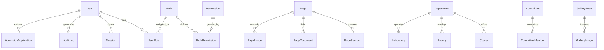

# PACE ITS — Database Architecture & Schema Specification

**Organization:** GT InnoX LLP  
**Client Project:** PACE Institute of Technology & Sciences  
**ORM:** Prisma 5.22.0  
**Database Engines Supported:** PostgreSQL (Production) / SQLite (Embedded / Local Dev)  
**Schema File:** `prisma/schema.prisma`  

---

## 1. Relational Entity Domain Overview

The database schema is normalized across 9 distinct institutional domains:

---

## 2. Table-by-Table Data Dictionary

### 2.1 Authentication & RBAC

1. **`User`**:
   - `id` (UUID Primary Key)
   - `email` (Unique String, Indexed)
   - `name` (String)
   - `passwordHash` (Bcrypt Salt-Hashed String)
   - `departmentId` (Nullable Foreign Key for HOD/Faculty scope)
   - `isActive` (Boolean, default true)
   - `createdAt`, `updatedAt`
2. **`Role`**:
   - `id` (UUID PK), `name` (Unique: `SUPER_ADMIN`, `WEBSITE_ADMIN`, `PRINCIPAL`, `ADMISSION_MANAGER`, `HOD`, `FACULTY_EDITOR`, `PLACEMENT_OFFICER`, `RESEARCH_COORDINATOR`, `COMMITTEE_COORDINATOR`, `GALLERY_EDITOR`, `CONTENT_EDITOR`, `READONLY_AUDITOR`)
3. **`Permission`**:
   - `id` (UUID PK), `action` (e.g. `page:create`, `page:edit`, `admission:update`, `document:upload`)
4. **`UserRole` & `RolePermission`**:
   - Composite-indexed join tables with cascade deletions.
5. **`Session`**:
   - Stateful token revocation tracking with expiration timestamps.
6. **`AuditLog`**:
   - Immutable security trail recording `userId`, `action`, `entityType`, `entityId`, `details` (JSON before/after diff), and `ipAddress`.

### 2.2 Content Management & Pages

1. **`Page`**:
   - `id` (UUID PK)
   - `canonicalPath` (Unique String, e.g. `/academics/departments/cse`)
   - `title`, `section`, `category`, `template`
   - `status` (`DRAFT`, `PUBLISHED`, `ARCHIVED`)
   - `fullText` (Large text body)
   - `seoTitle`, `seoDesc`
2. **`PageSection`**:
   - Child tab panes and content blocks (`pageId`, `tabName`, `title`, `content`, `order`).
3. **`PageDocument`**:
   - Attached downloadable files with academic year and category metadata.
4. **`Redirect`**:
   - Automatic legacy and slug change redirects (`fromPath`, `toPath`, `isPermanent`).

### 2.3 Academics & Departments

1. **`Department`**:
   - `code` (Unique: `CSE`, `ECE`, `CIVIL`, `EEE`, `MECH`, `MBA`, `CME`, etc.)
   - `name`, `slug` (Unique), `type` (`UG`, `PG`, `DIPLOMA`), `intake`
   - `vision`, `mission`, `hodName`, `hodEmail`, `hodMessage`, `hodPhotoUrl`
2. **`Course`**:
   - Degree programs (`B.Tech`, `M.Tech`, `MBA`, `Diploma`), duration, and approved intake.
3. **`Faculty`**:
   - Faculty roster (`name`, `designation`, `qualification`, `experience`, `specialization`, `photoUrl`, `order`).
4. **`Laboratory`**:
   - Department labs (`name`, `description`, `equipment`, `imageUrl`).

### 2.4 Admissions

1. **`AdmissionApplication`**:
   - `applicationNo` (Unique, auto-generated sequence e.g. `PACE-2026-0001`)
   - `candidateName`, `fatherName`, `dob`, `gender`, `category` (`OC`, `BC`, `SC`, `ST`)
   - `phone`, `email`, `address`, `marksPercent`, `entranceRank`
   - `programType` (`B.Tech`, `M.Tech`, `MBA`)
   - `branchPref1`, `branchPref2`, `branchPref3`
   - `status` (`NEW`, `CONTACTED`, `UNDER_REVIEW`, `APPROVED`, `REJECTED`, `CLOSED`)
   - `internalNotes`, `assignedToId` (FK to User)

### 2.5 Placements, Research & Campus

1. **`PlacementRecord`**:
   - Year-wise company selections, salary packages (`packageLpa`), on-campus flags.
2. **`Recruiter`**:
   - Partner organizations (`name`, `logoUrl`, `website`, `tier`).
3. **`Patent`**:
   - Official intellectual property records (`title`, `inventors`, `appNumber`, `status`, `filingDate`, `publishedDate`, `pdfUrl`).
4. **`GalleryEvent` & `GalleryImage`**:
   - Event photo albums for all 204 event archives.
5. **`NewsArticle` & `WebsiteSetting`**:
   - Homepage announcements ticker, global contact, and institutional settings.

